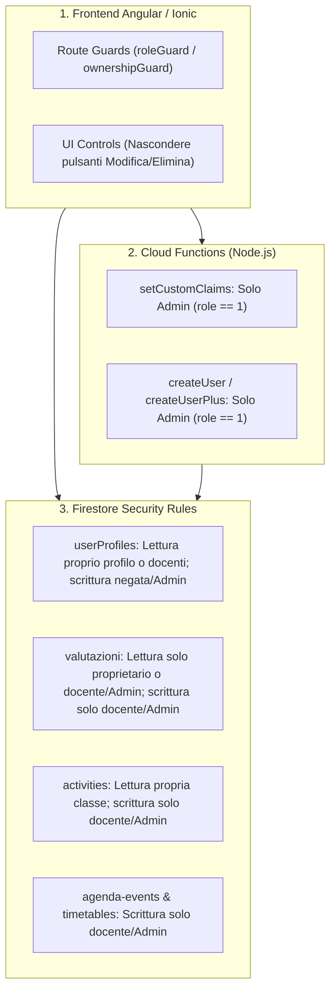

# Piano di Implementazione: Risoluzione Vulnerabilità Ruolo Studente

## 1. Obiettivo e Panoramica

L'obiettivo di questo intervento è garantire in modo rigoroso e multilivello (Database, Cloud Functions e Client Frontend) che un utente con ruolo **Studente** (`UsersRole.STUDENT = 3`):
1. **Non possa visualizzare altri utenti** (né altri studenti, né profili completi di terzi; può visualizzare solo i docenti della propria classe e il proprio profilo).
2. **Non possa creare, modificare o cancellare valutazioni** e possa accedere **esclusivamente alle proprie**.
3. **Non possa creare, modificare o cancellare attività** (compiti, verifiche, lezioni).
4. **Non possa accedere a funzioni riservate a Docenti o Segreteria** (modifica custom claims, orario docenti, interrogazioni, gestione classi e materie, agenda completa).

---

## 2. Architettura di Sicurezza a 3 Livelli

---

## 3. Dettaglio delle Modifiche per Fase

### Fase 1: Cloud Functions (Backend Authorization & Privilege Escalation Fix)

* **File interessati:**
  * [`functions/src/index.ts`](file:///home/giuseppe/Documenti/projects/schoolDiary/functions/src/index.ts)
  * [`functions/src/bussines/createUser.ts`](file:///home/giuseppe/Documenti/projects/schoolDiary/functions/src/bussines/createUser.ts)
  * [`functions/src/bussines/createUserPlus.ts`](file:///home/giuseppe/Documenti/projects/schoolDiary/functions/src/bussines/createUserPlus.ts)

* **Azioni:**
  1. In `setCustomClaims`:
     * Verificare che `request.auth` sia presente.
     * Verificare che `request.auth.token.role === UsersRole.ADMIN`. Se non è admin, lanciare `functions.https.HttpsError('permission-denied', 'Solo la segreteria o un amministratore può assegnare ruoli')`.
  2. In `createUser` e `createUserPlus`:
     * Verificare che `request.auth.token.role === UsersRole.ADMIN`. Gli studenti e i docenti non possono creare nuovi account utente né assegnare ruoli.

---

### Fase 2: Firestore Security Rules (`firestore.rules`)

* **File interessato:**
  * [`firestore.rules`](file:///home/giuseppe/Documenti/projects/schoolDiary/firestore.rules)
  *(Nota: come da linee guida, la stesura delle regole sarà affidata allo specialista `firestore-rules-author`)*

* **Regole specifiche da definire:**
  1. **Helper Functions:**
     * `isAuthenticated()`: `request.auth != null`
     * `isAdmin()`: `isAuthenticated() && request.auth.token.role == 1`
     * `isTeacher()`: `isAuthenticated() && request.auth.token.role == 2`
     * `isStudent()`: `isAuthenticated() && request.auth.token.role == 3`
     * `isOwner(uid)`: `isAuthenticated() && request.auth.uid == uid`
  2. **Collezione `userProfiles/{userId}`:**
     * `allow read`: consentita se `isOwner(userId)` oppure `isAdmin()` oppure (`isTeacher()` per studenti delle proprie classi) oppure (`isStudent()` se il documento richiesto è di un docente della sua classe `role == 2`). È **vietato** allo studente elencare o leggere profili di altri studenti.
     * `allow write`: consentita solo a `isAdmin()` o `isOwner(userId)` per campi non privilegiati (bloccando modifiche a `role`, `classKey`, `assignedClasses`).
  3. **Collezione `valutazioni/{valutazioneId}`:**
     * `allow read`: consentita se `isAdmin()`, `isTeacher()` oppure se `isStudent() && resource.data.studentKey == request.auth.uid`.
     * `allow write` (create, update, delete): consentita **solo** a `isTeacher()` o `isAdmin()`. **Negata categoricamente agli studenti**.
  4. **Collezione `activities/{activityId}`:**
     * `allow read`: consentita se autenticato e appartiene alla classe dell'attività (`request.auth.token.classKey == resource.data.classKey` o docente assegnato o admin).
     * `allow write`: consentita **solo** al docente autore (`isTeacher() && request.auth.uid == request.resource.data.teacherKey`) o `isAdmin()`.
  5. **Collezione `agenda-events/{eventId}` e `timetable`:**
     * `allow read`: per classe o docente.
     * `allow write`: consentita **solo** a `isTeacher()` o `isAdmin()`.

---

### Fase 3: Routing Angular & Guards

* **File interessati:**
  * [`src/app/app.routes.ts`](file:///home/giuseppe/Documenti/projects/schoolDiary/src/app/app.routes.ts)
  * Nuova guardia o estensione: [`src/app/shared/guards/owner-or-role.guard.ts`](file:///home/giuseppe/Documenti/projects/schoolDiary/src/app/shared/guards/)

* **Azioni:**
  1. Proteggere con `roleGuard` (`roles: [UsersRole.ADMIN, UsersRole.TEACHER]`):
     * `/classes-selector`
     * `/evaluation/:studentKey/:classKey/:teacherKey`
     * `/evaluations4-activity/:activityKey`
     * `/evaluations4-student/:studentKey/:teacherKey`
     * `/agenda` *(la visualizzazione per studenti è già integrata in sola lettura nella dashboard studente)*
     * `/timetable`
     * `/interrogations4user/:studentKey`
     * `/progress/:studentKey/:subjectsKey`
  2. Proteggere con verifica di ownership:
     * `/profile/:userKey`: aggiungere una guardia o controllo nel componente che reindirizzi se `loggedUser.role === STUDENT && loggedUser.key !== userKey`.
     * `/pdf-evaluation/:evaluationKey`: aggiungere controllo per verificare che la valutazione appartenga allo studente loggato (se il ruolo è studente).

---

### Fase 4: Bonifica Componenti UI

* **File interessati:**
  * [`src/app/pages/activities/activity-detail/activity-detail.component.html`](file:///home/giuseppe/Documenti/projects/schoolDiary/src/app/pages/activities/activity-detail/activity-detail.component.html) e [`.ts`](file:///home/giuseppe/Documenti/projects/schoolDiary/src/app/pages/activities/activity-detail/activity-detail.component.ts)
  * [`src/app/pages/users/components/evaluation4-student/evaluation4-student.component.html`](file:///home/giuseppe/Documenti/projects/schoolDiary/src/app/pages/users/components/evaluation4-student/evaluation4-student.component.html) e [`.ts`](file:///home/giuseppe/Documenti/projects/schoolDiary/src/app/pages/users/components/evaluation4-student/evaluation4-student.component.ts)

* **Azioni:**
  1. In `ActivityDetailComponent`:
     * Nascondere il FAB di modifica `@if (!isEditMode && canEdit())` dove `canEdit()` è vero solo se l'utente è un docente o admin.
     * Bloccare l'invocazione di `onSubmit()` se il ruolo è studente.
  2. In `Evaluation4StudentComponent`:
     * Correggere `userCanEdit(evaluation)` rimuovendo il `return true;` cablato.
     * Nel template HTML, proteggere i pulsanti "Modifica", "Elimina" e il menu ActionSheet con `@if (userCanEdit(evaluation))`.

---

## 4. Matrice di Verifica Post-Implementazione

| Funzionalità testata | Azione tentata da Studente | Risultato atteso |
| :--- | :--- | :--- |
| **Profilo terzi** | Navigazione a `/profile/<altro_uid>` | Reindirizzamento a `/dashboard` |
| **Lista utenti** | Query Firestore su `userProfiles` per altri studenti | Errore Firestore `permission-denied` |
| **Creazione valutazione** | Navigazione a `/evaluation/...` o chiamata `addEvaluation` | Navigazione bloccata da guard; `permission-denied` da Firestore |
| **Modifica/Elimina valutazione** | Chiamata `updateEvaluation` / `deleteEvaluation` | `permission-denied` da Firestore; pulsanti assenti nella UI |
| **Valutazioni di altri** | Query su `valutazioni` con ID di un altro studente | `permission-denied` da Firestore |
| **Modifica attività** | Apertura `/activity-detail/...` e salvataggio | Nessun tasto modifica nella UI; `permission-denied` da Firestore |
| **Agenda docente & Orario** | Navigazione a `/agenda` o `/timetable` | Navigazione bloccata da `roleGuard` con redirect a `/dashboard` |
| **Privilege Escalation** | Invocazione callable `setCustomClaims` | Errore `permission-denied: Solo la segreteria...` |

---

## 5. Prossimi Passi

Se confermi il piano, procederemo nell'ordine stabilito:
1. Hardening e messa in sicurezza delle **Cloud Functions** (`setCustomClaims`, `createUser`, `createUserPlus`).
2. Delega al subagent specializzato `firestore-rules-author` per la stesura e validazione di `firestore.rules`.
3. Aggiornamento delle **rotte Angular** in `app.routes.ts` con le opportune guardie di ruolo e ownership.
4. Aggiornamento dei **componenti UI** (`ActivityDetailComponent`, `Evaluation4StudentComponent`) per rimuovere controlli e azioni riservati ai docenti.
